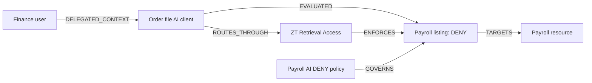

# Security Graph

The **Security Graph** page shows relationships derived from recorded security activity in the selected tenant and workspace. Use it to understand who requested an operation, which AI acted on the request, which enforcement boundary handled it, which resource was targeted, and which policies matched.

The graph describes observed activity. It is not a complete infrastructure inventory, an attack simulation, or an authorization mechanism. Access decisions and execution remain in the existing ZT gateways and policy pipelines.

## Open and use the page

1. Sign in to the dashboard with a role authorized to view Security Graph.
2. Choose the workspace where the request was evaluated. Order tools and file tools can belong to different workspaces.
3. Open **Audit & Analysis → Security Graph**.
4. Read the summary cards, node columns and relationship list.
5. Click a summary card to open its related detail view. Use the dashboard refresh button to reload the snapshot.
6. Open **Audit Logs** in the same workspace for original event references, decisions, timestamps and paginated history.

The dashboard requests a **120-minute activity window** and refreshes at its configured dashboard interval. An older test will disappear from this window while its retained audit record can still be available in Audit Logs.

## Where the data comes from

The graph reads the common `security_activities` ledger. Its sources include Workflow Chat, MCP order calls, file retrieval, delegation, approvals, execution records and other integrated lifecycle events.

Actual behavior anomalies are included when their request IDs match activity visible in the selected graph snapshot. A policy rejection alone does not create a behavior anomaly.

The graph uses recorded identity, resource and policy references. It does not copy file contents, raw prompts, tool arguments or credentials into the visualization.

## Node types

| Type | Meaning |
| --- | --- |
| `IDENTITY` | A recorded caller or delegating human |
| `AGENT` | An AI subject associated with recorded activity |
| `MCP_GATEWAY` | The ZT MCP enforcement boundary represented for recorded MCP activity |
| `RETRIEVAL_GATEWAY` | The ZT retrieval enforcement boundary represented for recorded file activity |
| `ACTION` | An individual recorded operation or lifecycle observation |
| `RESOURCE` | The target reference, such as a tool ID, file ID or saved workflow record |
| `POLICY` | A policy referenced by an event's stored matched-policy evidence |
| `BEHAVIOR` | A real behavior anomaly associated with a visible request |

The current graph does not add every registered agent, tool or policy merely because it exists in configuration. Nodes appear through recorded activity and its references. Gateway nodes identify enforcement boundaries; they are not a count of containers, upstream servers or network connections.

## Relationship types

| Relationship | Interpretation |
| --- | --- |
| `DELEGATED_CONTEXT` | A recorded human context is associated with an AI subject. This does not grant unrestricted access. |
| `ROUTES_THROUGH` | The recorded actor is associated with the applicable gateway boundary. |
| `ENFORCES` | The boundary handles the recorded action. This is not proof that an external operation succeeded. |
| `EVALUATED` | An authorization-stage event records evaluation of an action, including ALLOW, STEP_UP or DENY. |
| `EXECUTED` | An execution-stage record has `SUCCEEDED` or `TOOL_ERROR` status. Inspect the original result to determine business success. |
| `OBSERVED` | A lifecycle or other stage was recorded without claiming successful external execution. |
| `TARGETS` | The action references the target resource. A blocked attempt still has a target. |
| `GOVERNS` | A stored matched-policy reference applies to the recorded action. |
| `ANOMALY` | A real detector record is associated with the agent. |

An **ALLOW** evaluation does not, by itself, create an `EXECUTED` relationship. A **DENY** evaluation is represented as an evaluated, blocked attempt. Approval and delegation events are lifecycle evidence, not proof of resource access.

## Example: AI access to Payroll is denied

Assume finance can read Payroll as a human, but a published ZT policy denies the delegated AI access to Payroll and its descendants.



The Payroll resource appears because the AI targeted it. Its presence does **not** mean the AI read its contents. Check the recorded decision, returned count and original audit reference in Audit Logs. For a denied listing, no file content should be returned.

Human delegation and session revocation can also appear as observed actions. They do not override the file-access DENY or count as additional successful file reads.

## Example: order creation requires approval

1. The AI requests `createOrder` through the MCP gateway.
2. The authorization stage records `STEP_UP`; the tool has not executed.
3. An independent human approves the saved request. The approval is a lifecycle event.
4. Resuming the saved call rechecks the current authorization requirements.
5. A recorded execution-stage success produces an `EXECUTED` relationship.

Initial evaluation and resume-time evaluation can be separate action nodes because they are distinct recorded checks. Approval does not itself execute the order. An execution `TOOL_ERROR` means the tool invocation returned an error; it is not a successful order creation.

## Summary cards and risk labels

| Card | Meaning |
| --- | --- |
| **Graph nodes** | Unique nodes built for the current snapshot |
| **Edges** | Relationship entries built from the loaded records; repeated observations can produce repeated relationships |
| **Max risk** | Highest measured common-event risk score in the loaded snapshot |
| **Anomalies** | Real behavior anomaly records associated with visible request IDs |
| **MCP gateways** | Represented MCP gateway nodes; retrieval gateways are a separate node type |

**Not measured** means no event risk score was recorded. It does not mean the request was assigned zero risk. File ACL and AI-policy decisions currently do not calculate a separate runtime risk score.

Agent and action node risk values summarize available recorded scores. Repeated nodes retain the highest supplied score, while their status/label can reflect a later processed observation. A resource node is not a separate resource-risk assessment. Inspect individual events for precise outcomes and chronology.

Behavior nodes show detector scores. These scores should not be confused with the **Max risk** card, which uses measured common-event risk scores.

## Scope, permissions and display limits

- Graph requests use `X-Tenant-Id` and the selected `X-Workspace-Id`.
- The endpoint permits `PLATFORM`, `ADMIN`, `AUDITOR` and `AGENT_MANAGER` roles. Event visibility is also enforced: platform/admin/auditor readers can see the authorized workspace; an agent-manager role alone does not grant access to every caller's event.
- JWT workspace access is checked against current server grants. Switching the workspace changes which activity can appear.
- A snapshot loads up to **1,000 recent visible events**. Its counts describe that snapshot, not all retained history.
- The current canvas shows up to **8 nodes per type** and the first **40 relationship entries**. The summary can therefore count more nodes or edges than are drawn on screen.
- Events with no recorded AI subject or caller cannot form an actor relationship and may not appear as nodes.
- Historical imports preserve available evidence. Missing identities, unrecorded transitions and unknown workspace assignments are not reconstructed by guessing.

The node columns organize entity types; they are not a chronological execution trace or a network topology map.

## Empty graph or unexpected results

| Symptom | What to inspect |
| --- | --- |
| Empty graph after a test | Selected workspace, request timestamp and whether the operation reached ZT |
| Events in Audit Logs but few graph nodes | Snapshot window, display limits and whether caller/AI attribution was recorded |
| Payroll shown although access was denied | Read the action's DENY decision; `TARGETS` records the attempted target, not access |
| Zero anomalies after denied calls | Normal policy enforcement does not automatically indicate anomalous behavior |
| Risk says Not measured | The event has no measured score; file authorization currently uses this representation |
| An approved order has no execution edge | The saved call still needs to be resumed, or no successful/tool-error execution state was recorded |
| 403 response | Login role, token and current workspace access |

## API and related documentation

```http
GET /v1/security-graph?windowMinutes=120
X-Tenant-Id: <tenant UUID>
X-Workspace-Id: <authorized workspace UUID>
Authorization: Bearer <access token>
```

The snapshot response contains `nodes`, `edges`, `metrics`, `generatedAt`, `tenantId`, `workspaceId` and `windowMinutes`. The service bounds its activity window to 5–10,080 minutes.

`GET /v1/security-graph/stream` provides a separate bounded SSE stream. It attempts a snapshot every five seconds for up to twelve emissions; clients must reconnect for further updates. The dashboard page currently uses ordinary snapshot polling.

- [Common security event contract](../api/COMMON_SECURITY_EVENTS_V1.md)
- [Audit history and metric details](../demo/AUDIT_AND_METRIC_DETAILS.ko.md)
- [MCP execution and approval](../api/MCP_GATEWAY_EXECUTION.md)
- [Retrieval control plane](../api/RETRIEVAL_CONTROL_PLANE_V2.md)

The graph does not demonstrate TEE attestation, cryptographic audit sealing, compliance certification or the absence of direct upstream bypass paths. Those require their own controls and evidence.
